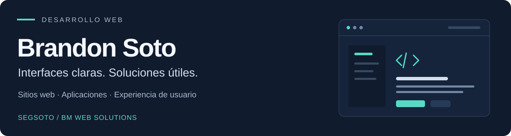

  

  
  

## Sobre mí

Soy **Brandon Soto**, desarrollador web. Trabajo en sitios y aplicaciones para negocios y formo parte de **BM Web Solutions**.

Me interesa crear interfaces que se entiendan con facilidad, funcionen bien en distintos dispositivos y ayuden a las personas a completar lo que necesitan. En mis repositorios comparto proyectos de desarrollo web, desde sitios de presentación hasta aplicaciones de gestión.

**Abierto a proyectos, colaboraciones y oportunidades laborales en desarrollo web.**

## Tecnologías

  
  
  
  
  
  

**Interfaces:** HTML, CSS, JavaScript y React.  
**Herramientas de desarrollo:** Node.js, Git y GitHub.

## Proyectos seleccionados

| Proyecto | Qué encontrarás | Enlaces |
| :--- | :--- | :--- |
| **BM Web Solutions** | Sitio bilingüe de servicios y portafolio. Generación de páginas estáticas con Node.js, navegación accesible y presentación de proyectos en escritorio y móvil. | [Código](https://github.com/Segsoto/bmwebsolutionscr) · [Sitio web](https://www.bmwebsolutionscr.com/) |
| **Charlie Mensajería** | Sitio corporativo construido con React y generación de HTML estático. Servicios, proceso de trabajo y preparación de solicitudes de contacto. | [Código](https://github.com/Segsoto/charlymensajeria) · [Sitio web](https://charliemensajeria.com/) |
| **AlmaBela** | Sitio de presentación con páginas de servicios, información del negocio y contacto, desarrollado con HTML, CSS y JavaScript. | [Código](https://github.com/Segsoto/AlmaBelaCR) · [Sitio web](https://almabela.com/) |

[Explorar todos mis repositorios →](https://github.com/Segsoto?tab=repositories)

## Mi enfoque

- **Claridad:** contenido organizado, navegación sencilla y acciones fáciles de encontrar.
- **Cuidado de la interfaz:** adaptación a diferentes pantallas, accesibilidad e interacciones con propósito.
- **Mantenimiento:** código organizado y documentación que facilite continuar el proyecto.

## Conversemos

Si buscas desarrollar un sitio, colaborar en un proyecto o conversar sobre una oportunidad laboral, puedes contactarme a través de [BM Web Solutions](https://www.bmwebsolutionscr.com/contacto).

English · Professional overview

### Hi, I'm Brandon Soto

I'm a web developer and part of **BM Web Solutions**. I work on websites and business applications, with an interest in clear interfaces, responsive layouts and maintainable code.

My repositories include business websites and management applications. The selected projects above feature HTML, CSS, JavaScript, React and Node.js.

I'm open to freelance projects, collaboration and web development opportunities. Visit my [portfolio](https://www.bmwebsolutionscr.com/) or [get in touch](https://www.bmwebsolutionscr.com/contacto).

